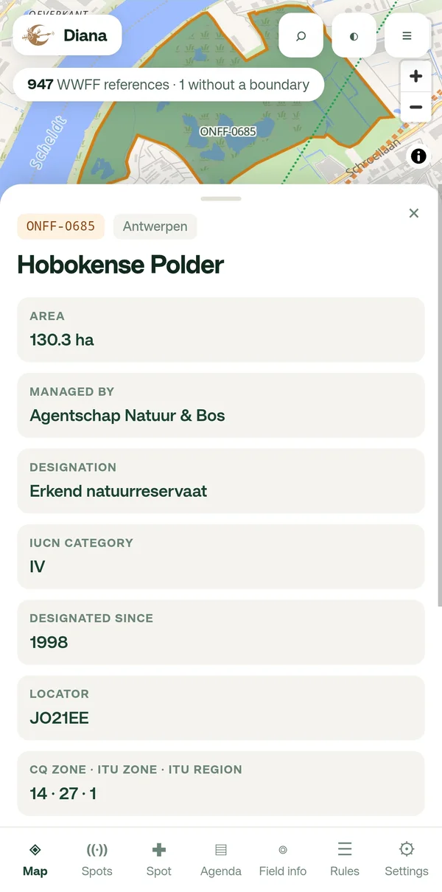

Tryk på et område, en prik eller et spot på kortet. Et panel glider op nedefra med alt, hvad Diana ved om den reference. Diana viser kun, hvad den faktisk ved: aldrig et tomt felt.

## Hvad står der i panelet

For et **område med grænse**:

- Reference, region og navn.
- Hvad områdefilen indeholder: **areal** i hektar, **forvalter**, **betegnelse**, **IUCN-kategori**, **udpeget siden**. Ikke alle reservater har det hele; det er et hul i kildedataene, ikke noget Diana skjuler.
- **Antal QSO'er** og **seneste aktivering**, fra WWFF-fortegnelsen.
- **Locator**, **CQ-zone**, **ITU-zone** og **ITU-region**.
- **Mere info**: reservatets hjemmeside, når WWFF-fortegnelsen har en. Den åbner i din browser, så Diana og kortet bliver, hvor de var.

For en **reference uden grænse** (stiplet ring): det samme panel uden arealtallene, og en bemærkning om, at Diana ikke kan afgøre, om du er inde i den.

For en **blå prik** i et andet land: reference, land og navn, locator og zoner, **Fra dig** (retning og afstand), antal QSO'er eller **ATNO** i rødt hvis den aldrig er blevet aktiveret, og Mere info.

## Spot eller annoncér fra panelet

Nederst i hvert panel er der to knapper:

- **Spot dig selv her** åbner spot-formularen med referencen allerede udfyldt. Se [Spot dig selv](/da/guide/spots/spot-yourself/).
- **Annoncér en aktivering** åbner agenda-formularen med referencen udfyldt. Se [Annoncér en aktivering](/da/guide/spots/announce/).

## Luk panelet

Stryg panelet **nedad**, eller tryk på **×**. Kortet bliver, hvor det er. På en telefon er der kun ét panel forneden ad gangen.
