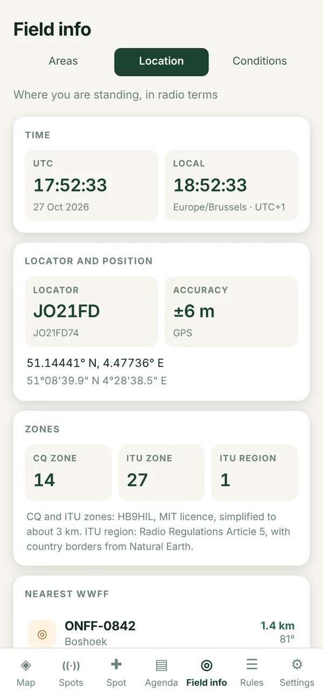

Der Reiter **Standort** gibt dir alles, was du über deinen eigenen Platz während eines QSOs oder für dein Log brauchst. Diana berechnet es auf deinem Gerät selbst, also klappt es auch ohne Empfang.

| Feld | Wie du es liest |
|---|---|
| **Zeit** | UTC und deine Ortszeit mit Zeitzone. Dein Log ist immer in UTC. |
| **Locator** | Dein Maidenhead-Locator mit sechs Zeichen (`JO21FD`) und mit acht (`JO21FD70`). Im QSO gibst du meist die sechs. |
| **Position** | In Dezimalgrad und in Grad, Minuten und Sekunden, mit der Genauigkeit in Metern. |
| **Zonen** | Deine CQ-Zone, ITU-Zone und ITU-Region. Belgien ist CQ 14, ITU 27, Region 1; Deutschland ebenfalls CQ 14, ITU 28. |
| *Grenze in der Nähe: auch …* | Du bist nah an einer Zonengrenze, oder deine Position ist unsicher. Dann sind beide Nummern möglich. |
| **Nächste WWFF** | Die nächsten Referenzen, überall auf der Welt, in Luftlinie. |

:::note[Woher die Zonen kommen]
Die CQ- und ITU-Zonen stammen aus einem öffentlichen Datensatz, vereinfacht auf etwa 3 km. Deshalb nennt das Feld nahe einer Grenze auch die Nachbarzone.
:::
