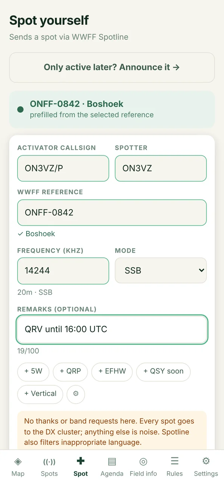

QRV und bereit? Spotte dich selbst, damit die Jäger dich finden. Der Spot geht an WWFF Spotline und von dort in den DX-Cluster.

## Schritt für Schritt

1. Tippe unten auf **Melden**, oder im Fenster eines Gebiets auf **Hier selbst spotten**.
2. Prüfe die **Referenz**. Stehst du in einem Gebiet, oder kommst du aus einem Fenster, hat Diana sie schon ausgefüllt und sagt, woher sie stammt.
3. Deine **Rufzeichen** kommen aus den Einstellungen: das Portable-Rufzeichen als Aktivierer, dein normales Rufzeichen als Spotter.
4. Trage die **Frequenz** in kHz ein, zum Beispiel `7144`, und wähle die **Betriebsart**.
5. Optional: eine kurze **Bemerkung**, bis zu 100 Zeichen. Tippe auf eines deiner **Schnellwörter**, um es mit einem Tippen hinzuzufügen.
6. Tippe auf **Prüfen**. Spotline sieht sich deinen Spot an, ohne ihn zu setzen, und sagt dir, was es davon hält.
7. Akzeptiert? Tippe auf **Spot senden**. Du bekommst eine Bestätigung mit der Nummer deines Spots.

## Warum erst Prüfen, dann Senden?

Jede Anfrage an Spotline geht von einem Budget ab, das sich alle Nutzer teilen. *Prüfen* sorgt dafür, dass ein Spot stimmt, bevor er ein echtes Senden kostet. Änderst du nach dem Prüfen etwas, schließt *Senden* wieder: die Freigabe galt für den Spot, wie er da war.

## Was Diana für dich prüft

- Das Format des **Rufzeichens**, den Bereich der **Frequenz** und die Länge der **Bemerkung**, genau wie Spotline.
- Den **Bandplan**: eine Warnung, wenn deine Betriebsart nicht zum Segment deiner Frequenz passt.
- Die **Referenz**, gegen Dianas eigene Liste. Das antwortet sofort, auch ohne Empfang.

:::caution[Was nicht in eine Bemerkung gehört]
Kein Dankeschön und keine Bandwünsche. Jeder Spot geht in den DX-Cluster, wo so etwas nur Rauschen ist. Spotline filtert außerdem unangemessene Sprache.
:::

## Wenn etwas schiefgeht

- **Bei schlechter Verbindung zweimal gedrückt?** Diana sagt, dass der Spot schon da war. Nichts wird doppelt gesetzt.
- **Spotline lehnt ab?** Du bekommst die Erklärung von Spotline selbst.
- **Senden geht gar nicht?** Diana bietet **Auf die alte Art senden** an: der Spot geht in einem neuen Tab an das eigene Formular von Spotline. Deren Antwort siehst du selbst, aber Diana kann sie nicht bestätigen.

Noch nicht QRV, nur am Planen? Nimm die Agenda: [Eine Aktivierung ankündigen](/de/guide/spots/announce/).
