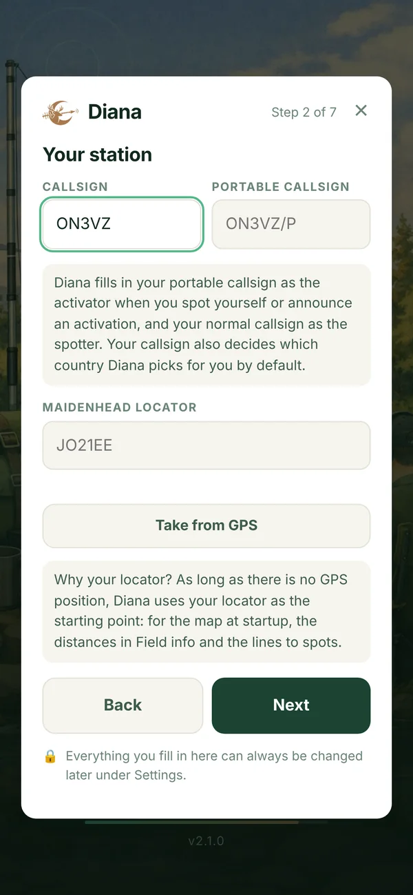

Direkt nach dem Willkommensbildschirm richtet ein kurzer Assistent Diana für deine Station ein. Das dauert etwa eine Minute. Jede Antwort wird in dem Moment gespeichert, in dem du sie gibst; wenn du mittendrin aufhörst, geht nichts verloren.

## Die Schritte

1. **Sprache.** Der Assistent startet auf Englisch. Tippe auf deine Sprache: EN, NL, FR, DE, DA, IT, ES oder PT. Alles wechselt sofort.
2. **Deine Station.**
   - **Rufzeichen**: dein normales Rufzeichen, zum Beispiel `DL1ABC`. Diana verwendet es als Spotter, und es bestimmt, welches Land Diana für dich auswählt.
   - **Portable-Rufzeichen**: was du im Gelände verwendest, zum Beispiel `DL1ABC/P`. Diana trägt es als Aktivierer ein, wenn du dich selbst spottest oder ankündigst.
   - **Maidenhead-Locator**: sechs Zeichen, zum Beispiel `JO31AB`. Tippe auf **Aus GPS übernehmen**, um ihn aus deiner Position zu füllen. Solange es keine GPS-Position gibt, geht Diana von deinem Locator aus: für die Karte beim Start, die Entfernungen in der Feldinfo und die Linien zu den Spots.
3. **Dein Land.** Welches Land Diana mit seinen echten Grenzen lädt. Diana schlägt eines anhand deines Rufzeichens vor. Siehe [Dein Land](/de/guide/settings/your-country/).
4. **Schnellwörter.** Fünf Wörter, die du mit einem Tippen zur Bemerkung eines Spots hinzufügen kannst. Tippe auf **Beispielwörter eintragen** für den Anfang, oder lass sie leer: ein leeres Feld ergibt einfach keine Taste.
5. **Bandliste.** **Alle Bänder** (160 m bis 23 cm) oder **Nur KW** (80, 40, 30, 20, 15 und 10 m) für die Liste beim Ankündigen einer Aktivierung.
6. **Statistik.** Nur wenn du noch nicht Ja gesagt hast: eine zweite, höfliche Frage, ob du mit anonymer Statistik helfen möchtest.
7. **Fertig.** Deine Einstellungen sind gespeichert. Sie bleiben im Browser dieses Geräts, solange du die Browserdaten nicht löschst.

Mit **Weiter** und **Zurück** wechselst du zwischen den Schritten. **Einführung überspringen** beendet den Assistenten; den Rest kannst du jederzeit in den Einstellungen ausfüllen.

:::note
Alles, was du hier eingibst, kannst du später unter **Einstellungen** ändern. Dort kannst du den Assistenten auch erneut starten: **Einstellungen** › **Startassistent erneut durchlaufen**.
:::

## Danach: der Rundgang

Am Ende bietet Diana einen kurzen Rundgang an. Siehe [Der Rundgang](/de/guide/start/tour/).
