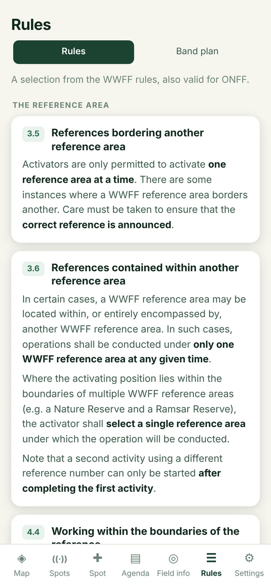

Toca **Reglas** en la barra de abajo. Se abre la pestaña **Reglas**: una selección de las reglas oficiales WWFF que más importan en el campo, en tu idioma.

## Qué contiene

Las reglas 3.5, 3.6, 4.4, 4.7, 6.8, 6.9 y 6.11 de las WWFF Global Rules, en tres grupos:

- **El área**: estar dentro del área de referencia, referencias que lindan con otra o la contienen, activar varias a la vez.
- **Los QSO**: reglas sobre los propios contactos.
- **Los logs**: cómo nombrar y subir tu log.

Son reglas WWFF, así que también se aplican al EAFF y a cualquier otro programa nacional.

:::note[Traducciones]
Los textos en otros idiomas los ha traducido el equipo de Diana. Vale el texto inglés del WWFF. Cada traducción enlaza al PDF oficial.
:::

## El nombre de tu archivo de log

La regla 6.8 exige un nombre de archivo concreto. Diana muestra un ejemplo con cada parte explicada:

`ON3VZ@ONFF-0104 20261002.adi`

| Parte | Significado |
|---|---|
| `ON3VZ` | Tu indicativo. |
| `@` | Separador. |
| `ONFF-0104` | La referencia. |
| (espacio) | Un espacio. |
| `20261002` | La fecha: año, mes, día. |
| `.adi` | Un archivo de log ADIF. |

La regla 6.9 remite a la búsqueda oficial de logs del WWFF: [wwff.co/logsearch](https://wwff.co/logsearch/).

:::tip
Diana no lleva el log por ti. Te ayuda antes y durante la activación; tu log se queda en tu propio programa de log.
:::
