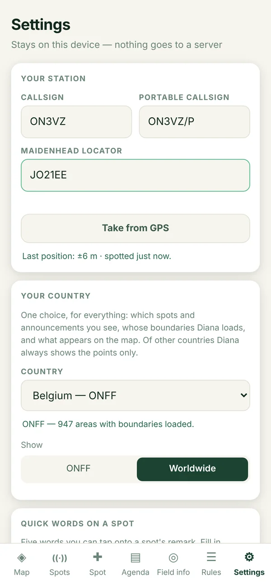

Todo lo que configuraste en el asistente, y algo más, está en **Ajustes**.

## Abrir Ajustes

1. Toca **Ajustes** en la barra de abajo (la rueda dentada, del todo a la derecha).
2. Desplázate hasta la parte que quieras cambiar.
3. Cámbiala. Todo se guarda al momento: no hay botón de guardar. Ves un instante *"Guardado en este dispositivo"*.

## Qué contiene

| Parte | Qué ajustas | Página |
|---|---|---|
| **Tu estación** | Indicativo, indicativo portátil, locator | [Tu estación](/es/guide/settings/your-station/) |
| **Tu país** | Qué país se carga en detalle, y el filtro de spots | [Tu país](/es/guide/settings/your-country/) |
| **Palabras rápidas para un spot** | Cinco palabras para añadir con un toque | [Palabras rápidas para un spot](/es/guide/settings/quick-words/) |
| **Info de campo** | Hasta dónde mira la pestaña Áreas a tu alrededor | [Distancia de Info de campo](/es/guide/settings/field-info-distance/) |
| **Lista de bandas al anunciar** | Todas las bandas o solo HF | [Lista de bandas al anunciar](/es/guide/settings/band-list/) |
| **Idioma** | Uno de ocho, o seguir el navegador | [Idioma](/es/guide/settings/language/) |
| **Privacidad** | Página de privacidad, estadísticas, borrar todo | [Privacidad y estadísticas](/es/guide/settings/privacy-settings/) |
| **Instalar como aplicación** | Instalar en este dispositivo | [Instalar en Android](/es/guide/start/install-android/) |
| Al final | Versión, actualizaciones, novedades, repetir el asistente | [Versión y actualizaciones](/es/guide/settings/version-and-updates/) |

:::caution[Solo en este dispositivo]
Todo lo que introduces aquí se queda en el navegador de este dispositivo. ¿Usas Diana también en otro dispositivo? Introdúcelo allí también. Diana no tiene cuenta para vincularlos. Consulta [Tus datos y los límites](/es/guide/help/data-and-limits/).
:::
