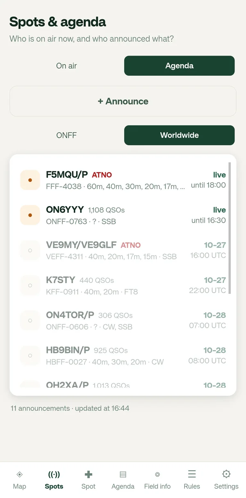

En la pantalla **Spots**, toca la pestaña **Agenda**. Ves todas las activaciones anunciadas, con referencia, bandas y modos, y fecha y hora en UTC.

## Leer la agenda

- **En curso ahora**: un punto naranja y *"en directo hasta …"*.
- **Por venir**: en gris, con fecha y hora de inicio.
- **ATNO** en rojo: la referencia nunca se ha activado.

Tu elección entre **tu país** y **Mundial** también vale aquí.

## Abrir un anuncio

Toca una línea. El mapa se abre en esa área con banda y modo, la reserva, el locator, la observación y el rumbo. **← Volver a Spots** te devuelve.

## Anunciar tú

Toca **+ Anunciar** arriba en la agenda. Consulta [Anunciar una activación](/es/guide/spots/announce/).

:::tip[También en el mapa]
Los anuncios aparecen en el mapa como un punto blanco con un anillo naranja, con una línea naranja discontinua desde ti. Consulta [Leer el mapa](/es/guide/map/reading-the-map/).
:::
