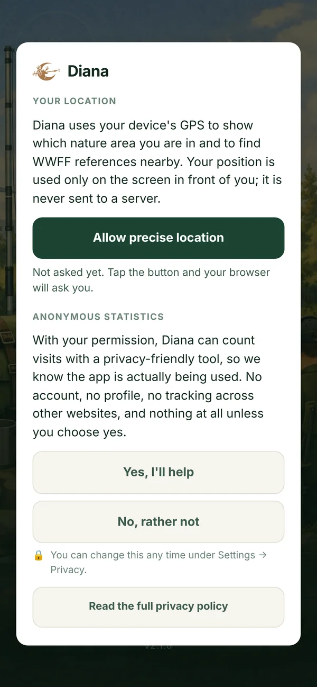

La première fois que vous ouvrez Diana, l’écran d’accueil pose deux questions. Rien n’est présélectionné : c’est vous qui choisissez.

## 1. Votre position

Diana utilise le GPS de votre appareil pour montrer dans quelle zone naturelle vous vous trouvez et pour trouver les références WWFF à proximité.

- **Votre position ne quitte jamais votre appareil.** Elle n’est utilisée que sur l’écran devant vous et n’est jamais envoyée à un serveur.
- **L’autorisation vaut uniquement pour Diana**, pas pour d’autres sites ou applications. Un navigateur accorde la position site par site.
- **Diana ne demande votre position que pendant que vous utilisez l’application**, quelques secondes à la fois. Jamais en arrière-plan.
- **Diana n’allume ni n’éteint votre GPS.** Cela reste du ressort d’Android ou d’iOS.

Touchez **Autoriser la position exacte**. Votre navigateur demande alors l’autorisation : choisissez **Autoriser** (sur un téléphone : « lorsque l’app est active » et avec la position **exacte**).

:::tip[Merci de dire oui à la position exacte]
Sans elle, Diana fonctionne quand même : vous saisissez alors votre locator dans les Réglages. Mais les fonctions les plus utiles ont besoin de votre vraie position : **suis-je dans la zone**, la distance jusqu’à la limite, les zones autour de vous et la référence déjà remplie quand vous vous annoncez. Une position approximative (±100 m ou pire) ne suffit pas pour savoir si vous êtes dans une zone.
:::

## 2. Statistiques anonymes

Avec votre permission, Diana compte les visites avec Umami, un outil respectueux de la vie privée. C’est ainsi que nous savons que l’application est vraiment utilisée, et quels écrans comptent.

- Pas de compte, pas de profil, pas de cookies, pas de suivi sur d’autres sites.
- Rien n’est compté sauf si vous choisissez **Oui, je participe**.
- Diana fonctionne exactement de la même façon, que vous disiez oui ou non.

:::tip[Merci de nous aider]
Diana est construite par des bénévoles sur leur temps libre. Savoir que des gens l’utilisent, et comment, est la seule récompense que nous recevons, et nous aide à décider quoi améliorer. Si vous le pouvez, choisissez **Oui, je participe**.
:::

Vous pouvez modifier ces deux réponses à tout moment dans **Réglages** › **Confidentialité**. Plus d’informations dans [Confidentialité](/fr/guide/start/privacy/).

## Ensuite

Juste après l’écran d’accueil vient [L’assistant de démarrage](/fr/guide/start/setup-wizard/).
