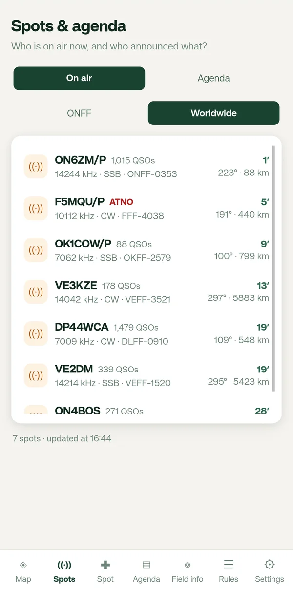

Tap **Spots** in the bottom bar. The screen **Spots & agenda** shows who is on the air from a WWFF area right now. The list comes live from WWFF Spotline and refreshes every 30 seconds.

## One line per station

| What you see | Meaning |
|---|---|
| Callsign | The activator, for example `F5MQU/P`. |
| QSO count | How many contacts were made from that reference before, according to the WWFF directory. |
| **ATNO** in red | *All Time New One*: this reference was never activated before. A hunter’s favourite. |
| Frequency, mode, reference | For example `10112 kHz · CW · FFF-4038`. |
| Minutes | How long ago the spot came in. |
| Bearing and distance | From you, for example `191° · 440 km`. |

## Your country or worldwide

Under the tabs you choose **your country** (for example ONFF) or **Worldwide**. Diana remembers the choice, and keeps it in step with the same setting in Settings. Which country the button stands for follows your country setting: until you pick one, Diana takes it from your callsign (ON… gives ONFF, PA… PAFF, DL… DLFF).

## Opening a spot

1. Tap a line.
2. The map opens, zoomed in on that area, with a sheet: frequency and mode, the reserve, the locator there and yours, the remark, the QSO count, More info and a compass with the bearing.
3. **← Back to Spots**, or the back button of Android, takes you back to the list.
4. **×** or swiping down closes only the sheet and keeps the map.

:::note[Spotline unreachable?]
Then the screen says so, rather than showing old spots without warning.
:::
