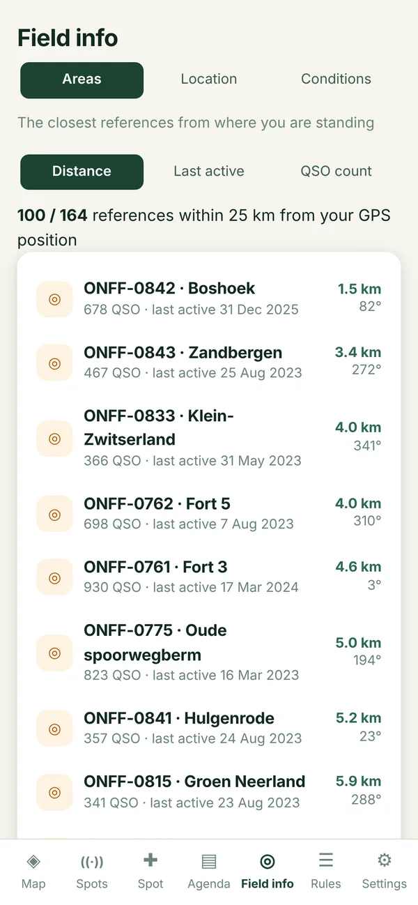

La scheda **Aree** elenca le referenze WWFF intorno alla tua posizione, entro la distanza scelta nelle Impostazioni (10, 25, 50 o 100 km). Ci sono anche le referenze oltre il confine.

## Una riga per referenza

| Cosa vedi | Significato |
|---|---|
| Referenza e nome | Per esempio `ONFF-0842 · Boshoek`. |
| Distanza e direzione | In linea d’aria da te, per esempio `1.5 km · 62°`. |
| Numero di QSO | Quanti collegamenti sono stati fatti da lì, secondo l’elenco WWFF. |
| Ultima attività | La data dell’ultima attivazione. |
| *nessuna data di attivazione nota* | L’elenco conosce la referenza ma non una data. |
| *non presente nell’elenco WWFF* | Diana conosce l’area, ma l’elenco non ha nulla. Non significa che non sia mai stata attivata. |

## Ordinare: quale ordine scegliere?

| Pulsante | Quando usarlo |
|---|---|
| **Distanza** | Le più vicine prima. Quando vuoi montare in fretta. |
| **Ultima attività** | Le aree rimaste più a lungo fuori dall’aria prima. È lì che un pile-up è più probabile. |
| **Numero di QSO** | Le aree meno lavorate prima. Quando vuoi offrire ai cacciatori una nuova. |

## Aprire un’area

1. Tocca una riga.
2. La mappa si apre, ingrandita su quell’area, con il suo pannello e il suo confine.
3. Più di cento aree vicine? Tocca **Mostra altri** in fondo.

## Cambiare la distanza

**Impostazioni** › **Info campo** › 10, 25, 50 o 100 km. Vedi [Distanza di Info campo](/it/guide/settings/field-info-distance/).

:::note
Il numero di QSO e le date arrivano dall’elenco WWFF, aggiornato ogni notte. Dove l’elenco non ha nulla, la schermata lo dice, invece di chiamarla "mai attivata".
:::
