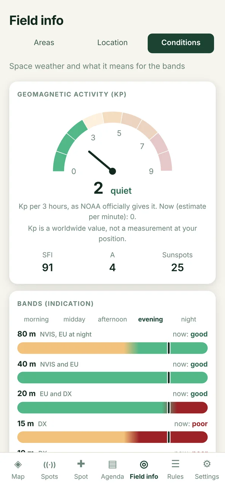

La scheda **Condizioni** inizia con il meteo spaziale di oggi: un indicatore con l’**indice Kp** e tre numeri sotto.

## L’indicatore Kp

Il Kp misura quanto è agitato il campo magnetico terrestre, su una scala da 0 a 9. Più è basso, meglio è per le bande alte. Diana mostra il valore ufficiale a tre ore della NOAA, e accanto una stima degli ultimi minuti.

| Kp | Parola in Diana | Cosa significa |
|---|---|---|
| da 0 a 2 | calmo | Nessun effetto. Condizioni normali. |
| 3 | instabile | Leggermente agitato. Di solito ancora nessun effetto evidente. |
| 4 | attivo | 20, 15 e 10 m scendono di un livello. |
| 5 e 6 | tempesta G1, G2 | Tempesta minore: 20, 15 e 10 m peggiorano. 80 e 40 m quasi non se ne accorgono. |
| da 7 a 9 | tempesta da G3 a G5 | Tempesta forte: tutte le bande peggiorano, quelle alte di più. |

:::note
Il Kp è un valore mondiale, non una misura nella tua posizione.
:::

## I tre numeri

| Numero | Cosa ti dice |
|---|---|
| **SFI** | Flusso solare. Più è alto, meglio si aprono le bande alte. Intorno a 70 è basso, sopra 150 è alto. |
| **A** | Quanto è stato agitato il campo magnetico nell’intera giornata. Basso è buono. |
| **Macchie solari** | Vanno di pari passo con lo SFI: più macchie, più possibilità di DX sulle bande alte. |

SFI, A e macchie solari sono valori giornalieri; Diana dice di quale giorno sono.

## Quanto sono vecchi i numeri?

Sotto l’indicatore c’è scritto quando i numeri sono stati aggiornati, per esempio *"Aggiornato alle 14:37 (12 min fa)"*. Diana prova a prenderli due volte all’ora, ma in pratica tra due aggiornamenti possono passare alcune ore.

- Più vecchi di **otto ore**: il messaggio diventa arancione.
- Valore Kp più vecchio di **dodici ore**: Diana lo segnala a parte.

La fonte è NOAA SWPC. Cosa significa per ogni banda: [Le barre delle bande](/it/guide/field-info/conditions-bands/).
