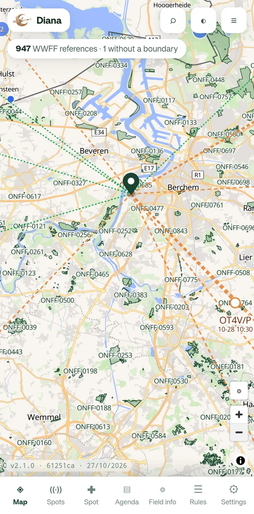

De kaart is het hoofdscherm van Diana. Al de rest begint hier.

## De balk onderaan

Van links naar rechts: **Kaart**, **Spots**, **Meld**, **Agenda**, **Veldinfo**, **Regels** en **Instellingen**. Tik erop om dat scherm te openen.

:::tip[Terug naar je eigen positie]
Tik op elk moment onderaan op **Kaart**: de kaart centreert opnieuw op waar je staat, en de zoom blijft zoals hij is. Diana neemt een nieuwe gps-meting als de vorige ouder was dan twee minuten of minder nauwkeurig dan 30 m. Zonder gps centreert ze op je locator uit Instellingen, en ze zegt dat erbij.
:::

## De knoppen bovenaan

| Knop | Wat hij doet |
|---|---|
| **⌕** | Zoeken op naam of referentienummer. Zie [Zoeken](/nl/guide/map/search/). |
| **◐** | Kaartstijl: Liberty, Positron, Bright of Dark. |
| **≡** | Lagen en taal. Zie [Lagen en kaartstijl](/nl/guide/map/layers-and-styles/). |

Linksboven staat hoeveel referenties er ingeladen zijn, bijvoorbeeld *"947 WWFF-referenties · 1 zonder grens"*.

## Bewegen op de kaart

- **Sleep** met één vinger om de kaart te verschuiven.
- **Knijp** met twee vingers om in of uit te zoomen, of gebruik **+** en **−** rechts.
- **Tik** op een gebied, een punt of een spot om het paneel te openen. Zie [Info over een gebied](/nl/guide/map/area-panel/).

## Wat zie ik?

De kleuren, punten en lijnen staan uitgelegd in [De kaart lezen](/nl/guide/map/reading-the-map/). Waarom de ene referentie een vlak is en de andere maar een punt, lees je in [Punten en vlakken](/nl/guide/map/points-and-areas/).
