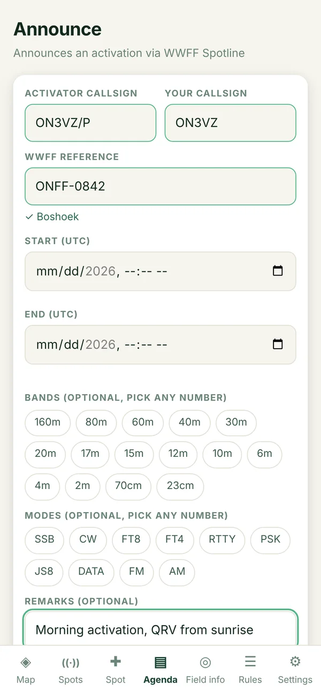

Een activatie gepland? Kondig ze aan, zodat hunters klaarzitten. De aankondiging gaat naar de WWFF-agenda op Spotline.

## Drie manieren om te starten

- **Agenda** onderaan in de balk.
- **+ Aankondigen** op het tabblad Agenda van het scherm Spots.
- **Activatie aankondigen** in het paneel van een gebied: dan staat de referentie al ingevuld.

## Stap voor stap

1. Kijk de **roepnaam van de activator** en **je eigen roepnaam** na. Iemand anders mag aankondigen voor een activator.
2. Vul de **WWFF-referentie** in, bijvoorbeeld `ONFF-0104`.
3. Kies **begin** en **einde**. Je kiest ze op de klok van je eigen toestel; Diana rekent ze om naar UTC voor ze je toestel verlaten.
4. Optioneel: vink de **banden** en **modes** aan (meerdere kan, bijvoorbeeld *40 m, 20 m · CW, SSB*) en voeg een opmerking toe.
5. Tik op **Controleren**, en als het aanvaard is, op **Aankondiging versturen**.
6. **Schrijf je pin op.**

:::danger[Bewaar je pin]
De pin is de enige manier om deze aankondiging later te wijzigen of te annuleren, op de eigen site van Spotline. Diana kan dat niet voor je doen, en een verloren pin is niet terug te halen. Daarom houdt Diana onder het formulier een lijst bij van alles wat je vanaf dit toestel aankondigde (referentie, datum, pin). Tik op **✕** om een regel te verwijderen. Die lijst staat alleen op dit toestel.
:::

## Grenzen

- Hoogstens **een maand** vooruit, en het einde niet voor het begin. Spotline hanteert dezelfde regels.
- Hoogstens **16 aankondigingen per dag** vanaf één toestel via Diana, om het gedeelde budget te beschermen. Gewoon gebruik blijft daar ver onder.
- Voor aankondigingen is er geen "oude manier". Lukt het niet, probeer dan later opnieuw.

Welke banden de lijst toont (alle, of alleen HF), is een instelling: [Bandenlijst bij aankondigen](/nl/guide/settings/band-list/).
