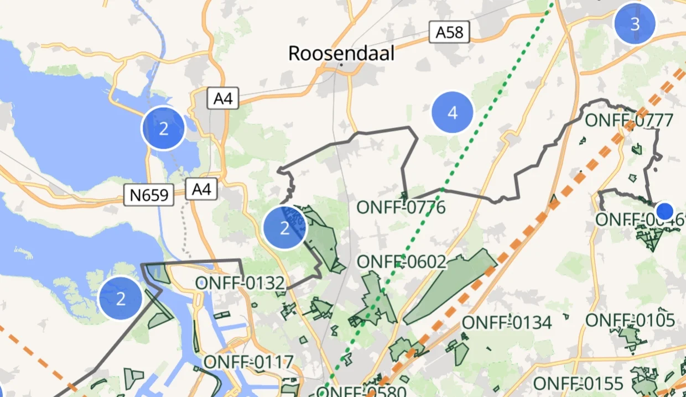

Tudo no mapa tem um significado. Esta é a legenda.

## Áreas e referências

| O que vês | Significado |
|---|---|
| Área verde com um número | Uma referência com o seu limite real, no teu país. O número é a referência, por exemplo `ONFF-0602`. |
| Contorno laranja | A área em que acabaste de tocar. |
| Anel tracejado com um ponto laranja | Uma referência do teu país sem limite: um local aproximado. |
| Ponto azul | Uma referência noutro país. |
| Círculo azul com um número | Vários pontos azuis juntos. Toca para aproximar; separa-se. |
| Linha cinzenta | Uma fronteira de país no mapa de base. |

A partir do nível de zoom 11, cada ponto recebe a sua referência como etiqueta.

## Spots e anúncios

| O que vês | Significado |
|---|---|
| Ícone de antena verde a pulsar | Uma estação no ar agora, com indicativo, frequência e modo ao lado. |
| **Linha verde pontilhada** | De ti até uma estação que está no ar agora. |
| Spot esbatido | Um spot com mais de 30 minutos. |
| Ponto branco com anel laranja | Uma ativação anunciada da agenda. |
| **Linha laranja tracejada** | De ti até uma ativação anunciada, com indicativo e hora. |
| A tua posição | Um marcador. Quando a tua posição é menos precisa do que cerca de 10 m, um anel tracejado mostra a margem. |

:::tip[Demasiadas linhas?]
Desliga-as em **≡** › **Linhas até aos spots**. O Diana lembra-se da escolha. **⤢ Ver todos os spots** enquadra todos os spots e a tua própria posição de uma vez.
:::

Porque é que algumas referências são áreas e outras pontos: [Pontos e áreas](/pt/guide/map/points-and-areas/).
