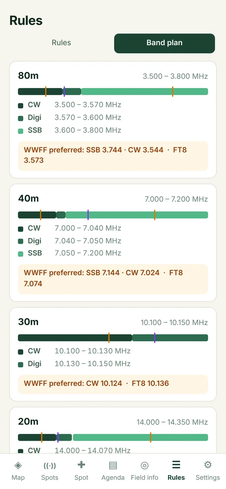

No ecrã **Regras**, toca no separador **Plano de bandas**.

## Como ler

Para cada banda:

- Uma **barra** com os segmentos de **CW**, **digital** e **SSB**, com as suas frequências, por exemplo *CW 3.500 a 3.570 MHz*.
- A frequência **FT8**, assinalada.
- As **frequências preferidas do WWFF**, destacadas numa caixa amarela, por exemplo *SSB 7.144 · CW 7.024*.

## Porque importa

Quando fazes o teu spot, Diana verifica a tua frequência contra este plano de bandas e avisa-te se o teu modo não encaixa no segmento. Vê [Faz o teu spot](/pt/guide/spots/spot-yourself/).

:::tip
Num dia de muitas ativações, começa perto da frequência preferida do WWFF: é aí que os caçadores escutam primeiro.
:::
